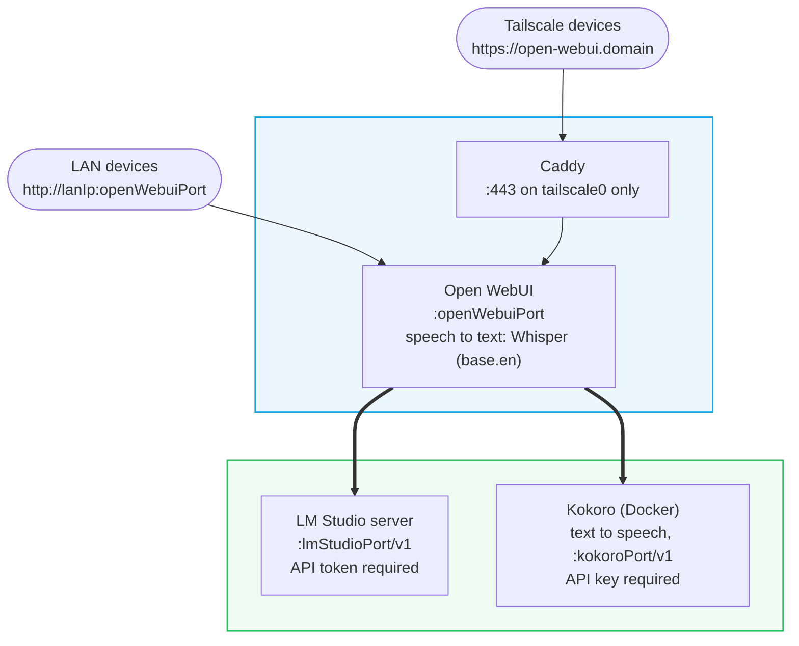

# AI

A chat interface for local models, split across two machines. The homelab runs
[Open WebUI](https://openwebui.com): the web UI, accounts and chat history. The
models themselves run in [LM Studio](https://lmstudio.ai) on an M4 Mac mini,
which has the GPU and memory for them. The homelab has neither.

In this page, `<domain>`, `<lanIp>`, `<macMiniIp>` and the ports are values
from `private.nix`.

## Overview

| Legend |
| --- |
| 🟦 Homelab  🟩 Mac mini |

You reach Open WebUI like any other service: plain HTTP on the LAN, or HTTPS
through Caddy on Tailscale. Open WebUI then calls the Mac mini over the LAN.
The Mac doesn't need Tailscale for this.

## The link between the two machines

| Part | Detail |
| --- | --- |
| Address | `http://<macMiniIp>:<lmStudioPort>/v1` (`OPENAI_API_BASE_URL`) |
| API | LM Studio's OpenAI-compatible API. Open WebUI's Ollama support is off (`ENABLE_OLLAMA_API = "False"`) |
| Auth | LM Studio's API token, sent as `Authorization: Bearer <token>`. Stored in sops as `OPENAI_API_KEY` in `open-webui-env` |
| Network | LAN only, plain HTTP |

- **Why the LAN and not Tailscale**: the API is only ever used by the homelab,
  which is on the same LAN, so it works without either machine depending on
  Tailscale.
- **Who can reach it**: LM Studio is open to the whole LAN, but requests
  without the token are refused.
- **Plain HTTP**: the token and prompts cross the LAN unencrypted, like the
  other services' LAN access. Fine on a trusted home network.
- **If the Mac is off or asleep**: Open WebUI still loads, but lists no models
  and can't reply.

## Mac mini: LM Studio

The Mac isn't managed by this repo, so these are set by hand. If the Mac is
rebuilt, set them again.

**LM Studio › Developer › Server Settings:**

| Setting | Value | Why |
| --- | --- | --- |
| Server Port | `1234` | Must match `lmStudioPort` |
| Require Authentication | On | Requests need the token |
| Serve on Local Network | On | Listens on the LAN instead of only `127.0.0.1` |
| Just-in-Time Model Loading | On | Open WebUI lists every downloaded model; one loads on its first request |
| Auto unload unused JIT loaded models | On, max idle TTL 10 minutes | Frees the Mac's memory when a model isn't being used |
| Only Keep Last JIT Loaded Model | On | Switching models in Open WebUI unloads the previous one |

**Elsewhere on the Mac:**

- **Fixed IP**: a DHCP reservation on the router, so `macMiniIp` stays correct.
- **Starts on its own**: LM Studio's "run the LLM server on login" setting is
  on. The server only starts once a user is logged in.
- **Stays awake**: automatic sleep is off (System Settings › Energy).

## Homelab: Open WebUI

`services/open-webui.nix`, using NixOS's `services.open-webui` module. Data
(accounts, chats) is in `/var/lib/open-webui`.

- **Listens on `0.0.0.0:<openWebuiPort>`**, with the firewall port open, so
  the LAN can reach it. Its default port of 8080 is taken by qBittorrent.
  Caddy serves it as `open-webui.<domain>` on Tailscale.
- **Settings come from Nix.** `ENABLE_PERSISTENT_CONFIG = "False"` makes the
  environment variables apply on every start. Settings changed in the admin
  panel are lost on restart, so change them in the module instead. Accounts,
  chats, workspace models and prompts, and each user's own settings (such as
  the theme) are kept.
- **Accounts**: sign-up is off (`ENABLE_SIGNUP = "False"`). The first account
  is the admin; add others under Admin Panel › Users.
- **Token counts**: `DEFAULT_MODEL_METADATA` turns on the "Usage" capability
  for every model, so LM Studio reports token counts and each reply shows them
  under its info icon.
- **No suggested follow-ups**: `ENABLE_FOLLOW_UP_GENERATION = "False"`
  turns off the list of suggested questions after each reply (and the first
  of them pre-filled in the message box), which would cost an extra request
  to the Mac after every answer. Models can still ask questions in
  their replies or with the `ask_user` tool.
- **No automatic tags**: `ENABLE_TAGS_GENERATION = "False"` stops the model
  labelling each chat by topic, another background request to the Mac. Tags
  can still be added by hand. Chat titles are still generated, by the chat
  model on the Mac.
- **Telemetry off**: setting `environment` replaces the module's own telemetry
  defaults, so they're restated. Version checks and community sharing are off
  too.
- **Secrets**: `open-webui-env` holds `WEBUI_SECRET_KEY` (signs logins),
  `OPENAI_API_KEY` (the LM Studio token) and `AUDIO_TTS_OPENAI_API_KEY` (the
  Kokoro key, see [Voice](#voice)). See [Secrets](secrets.md).

## Web search

Models can search the web and cite what they find. In Open WebUI's default
(Native) mode, search is a pair of tools the model calls when it decides it
needs to:

1. **`search_web`**: Open WebUI asks SearXNG, a search engine running on the
   homelab, and gives the model the title, link and snippet of the top
   results (`WEB_SEARCH_RESULT_COUNT`). See
   [Other services › SearXNG](other-services.md#searxng-search).
2. **`fetch_url`**: for a result worth reading, Open WebUI downloads the page
   and gives the model its text, cut off at `WEB_FETCH_MAX_CONTENT_LENGTH`.

The model can repeat these, for example searching again with a better query,
before it answers.

### The link to SearXNG

| Part | Detail |
| --- | --- |
| Address | `http://<namespace address>:<searxngPort>/search` (`SEARXNG_QUERY_URL`), or `127.0.0.1` when SearXNG is off the VPN |
| API | SearXNG's search URL with `format=json`. Open WebUI adds the query itself |
| Auth | None. SearXNG only answers on the homelab, the LAN and Tailscale |
| Network | Stays on the homelab: from the host into the VPN namespace, through SearXNG's port mapping |

- **The address follows SearXNG.** `open-webui.nix` checks whether SearXNG
  is confined to the VPN and picks the namespace address or `127.0.0.1` to
  match, so switching `useVpn` needs no change here.
- **Only the search goes through the VPN.** Open WebUI runs on the host, so
  `fetch_url` downloads pages over the home connection.
- **If SearXNG is down**, or every engine fails, the search returns nothing.
  Chat still works, just without web results.

### Open WebUI settings

All in `services/open-webui.nix`:

| Setting | Why |
| --- | --- |
| `ENABLE_WEB_SEARCH`, `WEB_SEARCH_ENGINE = "searxng"`, `SEARXNG_QUERY_URL` | Turn search on and point it at SearXNG |
| `WEB_SEARCH_RESULT_COUNT = "6"` | Results per search. They're only snippets, so more is cheap and gives the model more to choose from |
| `WEB_FETCH_MAX_CONTENT_LENGTH = "20000"` | Caps each fetched page at 20,000 characters (about 5k tokens), so one big page can't fill the context |
| `capabilities.web_search` in `DEFAULT_MODEL_METADATA` | Lets every model use search |
| `"web_search"` in `defaultFeatureIds` (`DEFAULT_MODEL_METADATA`) | Search starts switched on in every new chat. Turn it off per chat from the **+** menu |

## Documents and knowledge bases

Uploaded files and knowledge bases are split into chunks and turned into
embeddings, so Open WebUI can find the parts that match a question. Those
embeddings come from LM Studio on the Mac, not the homelab's CPU:

| Setting | Why |
| --- | --- |
| `RAG_EMBEDDING_ENGINE = "openai"` | Use an OpenAI-compatible API (LM Studio) for embeddings. The URL and token are the `OPENAI_` ones, so nothing else is needed |
| `RAG_EMBEDDING_MODEL` | The embedding model's ID in LM Studio |

If the embedding model changes, existing knowledge bases have to be
re-indexed, because their stored embeddings came from the old model.

## Tools: time and code

**Time**: Open WebUI's built-in `get_current_timestamp` and
`calculate_timestamp` tools give models the date and time, and do date
arithmetic. They're on by default in Native mode, so nothing is configured.
Local time uses the time zone the browser reports.

**Code interpreter**: the model can write and run Python, for exact maths,
dates and small data jobs. The code runs in the browser with Pyodide, so it
costs neither the homelab nor the Mac anything, and can't touch either.

| Setting | Why |
| --- | --- |
| `ENABLE_CODE_INTERPRETER = "True"`, `CODE_INTERPRETER_ENGINE = "pyodide"` | Turn it on, running in the browser |
| `capabilities.code_interpreter` in `DEFAULT_MODEL_METADATA` | Lets every model use it |

It starts switched on in every new chat (`defaultFeatureIds` in
`DEFAULT_MODEL_METADATA`); turn it off per chat from the **+** menu.

## Voice

| | Where it runs | Settings |
| --- | --- | --- |
| Speech to text | Local Whisper (`base.en`) in Open WebUI on the homelab | `AUDIO_STT_ENGINE = ""`, `WHISPER_MODEL = "base.en"` |
| Text to speech | [Kokoro](https://github.com/remsky/Kokoro-FastAPI) in Docker on the Mac mini | `AUDIO_TTS_ENGINE = "openai"`, `AUDIO_TTS_OPENAI_API_BASE_URL`, `AUDIO_TTS_MODEL = "kokoro"`, `AUDIO_TTS_VOICE` |

- **Whisper stays on the homelab**, so recordings don't leave it. The
  browser's own speech recognition (the "Web API" option) sends audio to
  Google or Apple. `base` is small enough to run on the laptop's CPU, and the
  English-only `.en` version is more accurate on English. It can't transcribe
  other languages; switch to plain `base` for those. A bigger model (such as
  `small.en`) is more accurate but slower.
- **The Whisper model downloads on first use**, into Open WebUI's cache in
  `/var/lib/open-webui`.
- **Kokoro runs on the Mac, not the device.** Open WebUI sends each sentence
  to the Mac and passes the audio on to the browser, so phones don't download
  or run a model. On the homelab's CPU it would be several seconds per
  sentence; on the Mac it keeps up with playback.
- **On the CPU, not the GPU**: Docker on macOS can't use the GPU. Kokoro is
  small enough that the CPU keeps ahead of playback, and it leaves the GPU to
  the chat model.
- **Voices**: `bf_emma` by default. Each user can pick another Kokoro voice
  in Settings › Audio, where the text-to-speech engine must be left on
  "Default": "Browser Kokoro" takes over from the Mac.

### The link to Kokoro

| Part | Detail |
| --- | --- |
| Address | `http://<macMiniIp>:<kokoroPort>/v1` (`AUDIO_TTS_OPENAI_API_BASE_URL`) |
| API | Kokoro-FastAPI's OpenAI-compatible speech API |
| Auth | An API key, sent as `Authorization: Bearer <key>`. Stored in sops as `AUDIO_TTS_OPENAI_API_KEY` in `open-webui-env`; without it Open WebUI would send the LM Studio token |
| Network | LAN only, plain HTTP, like LM Studio |

### Mac mini: Kokoro

Kokoro runs in Docker on the Mac mini.

| Setting | Value | Why |
| --- | --- | --- |
| Image | `ghcr.io/remsky/kokoro-fastapi-cpu:latest` | The CPU build, the only one Docker on macOS can run |
| Port | `8880` | Must match `kokoroPort` |
| `API_KEYS` | The same key as `AUDIO_TTS_OPENAI_API_KEY` | Requests without it are refused |
| `DEFAULT_VOICE` | `bf_emma` | Used when a request names no voice |
| `HF_HUB_DISABLE_TELEMETRY` | `1` | No check-in with Hugging Face at startup; the model is in the image |
| `ENABLE_WEB_PLAYER` | `false` | It can't send the API key, so it would only get errors |

- **Starts on its own**: `restart: unless-stopped` brings the container back
  whenever Docker starts, so Docker has to start at login.

## Mac mini: models for search and documents

- **Context length**: a fetched page can be up to 20,000 characters (about 5k
  tokens), on top of the conversation and search results. Give chat models
  at least 16k of context in LM Studio. Too short, and pages are cut off
  without warning.
- **Embedding model**: `ggml-org/embeddinggemma-300M-GGUF` (Q8_0), a small,
  text-only model. Its ID in LM Studio (`lms ls`) must match
  `RAG_EMBEDDING_MODEL`.
- **Keep it loaded**: load it by hand (Developer tab, or `lms load`) rather
  than relying on JIT loading. "Only Keep Last JIT Loaded Model" could
  otherwise unload the chat model whenever a document is embedded. To check,
  run `lms ps` before and after uploading a file: both models should still be
  listed.
