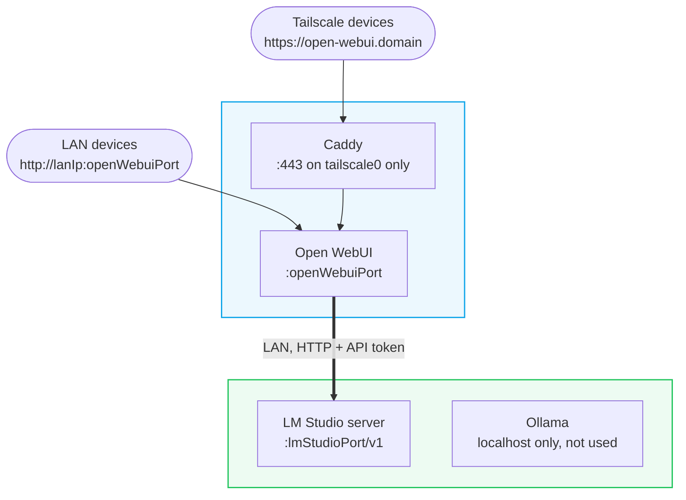

# AI

A chat interface for local models, split across two machines. The homelab runs
[Open WebUI](https://openwebui.com): the web UI, accounts and chat history. The
models themselves run in [LM Studio](https://lmstudio.ai) on an M4 Mac mini,
which has the GPU and memory for them. The homelab has neither.

In this page, `<domain>`, `<lanIp>`, `<macMiniIp>` and the ports are values
from `private.nix`.

## Overview

| Legend |
| --- |
| 🟦 Homelab  🟩 Mac mini |

You reach Open WebUI like any other service: plain HTTP on the LAN, or HTTPS
through Caddy on Tailscale. Open WebUI then calls the Mac mini over the LAN.
The Mac doesn't need Tailscale for this.

## The link between the two machines

| Part | Detail |
| --- | --- |
| Address | `http://<macMiniIp>:<lmStudioPort>/v1` (`OPENAI_API_BASE_URL`) |
| API | LM Studio's OpenAI-compatible API. Open WebUI's Ollama support is off (`ENABLE_OLLAMA_API = "False"`) |
| Auth | LM Studio's API token, sent as `Authorization: Bearer <token>`. Stored in sops as `OPENAI_API_KEY` in `open-webui-env` |
| Network | LAN only, plain HTTP |

- **Why the LAN and not Tailscale**: the API is only ever used by the homelab,
  which is on the same LAN, so it works without either machine depending on
  Tailscale.
- **Who can reach it**: LM Studio is open to the whole LAN, but requests
  without the token are refused. Ollama stays on the Mac's `localhost`, so it
  isn't reachable at all.
- **Plain HTTP**: the token and prompts cross the LAN unencrypted, like the
  other services' LAN access. Fine on a trusted home network.
- **If the Mac is off or asleep**: Open WebUI still loads, but lists no models
  and can't reply.

## Mac mini: LM Studio

The Mac isn't managed by this repo, so these are set by hand. If the Mac is
rebuilt, set them again.

**LM Studio › Developer › Server Settings:**

| Setting | Value | Why |
| --- | --- | --- |
| Server Port | `1234` | Must match `lmStudioPort` |
| Require Authentication | On | Requests need the token |
| Serve on Local Network | On | Listens on the LAN instead of only `127.0.0.1` |
| Just-in-Time Model Loading | On | Open WebUI lists every downloaded model; one loads on its first request |
| Auto unload unused JIT loaded models | On, max idle TTL 10 minutes | Frees the Mac's memory when a model isn't being used |
| Only Keep Last JIT Loaded Model | On | Switching models in Open WebUI unloads the previous one |

**Elsewhere on the Mac:**

- **Fixed IP**: a DHCP reservation on the router, so `macMiniIp` stays correct.
- **Starts on its own**: LM Studio's "run the LLM server on login" setting is
  on. The server only starts once a user is logged in.
- **Stays awake**: automatic sleep is off (System Settings › Energy).

## Homelab: Open WebUI

`services/open-webui.nix`, using NixOS's `services.open-webui` module. Data
(accounts, chats) is in `/var/lib/open-webui`.

- **Listens on `0.0.0.0:<openWebuiPort>`**, with the firewall port open, so
  the LAN can reach it. Its default port of 8080 is taken by qBittorrent.
  Caddy serves it as `open-webui.<domain>` on Tailscale.
- **Settings come from Nix.** `ENABLE_PERSISTENT_CONFIG = "False"` makes the
  environment variables apply on every start. Settings changed in the admin
  panel are lost on restart, so change them in the module instead. Accounts,
  chats, workspace models and prompts, and each user's own settings (such as
  the theme) are kept.
- **Accounts**: sign-up is off (`ENABLE_SIGNUP = "False"`). The first account
  is the admin; add others under Admin Panel › Users.
- **Token counts**: `DEFAULT_MODEL_METADATA` turns on the "Usage" capability
  for every model, so LM Studio reports token counts and each reply shows them
  under its info icon.
- **Telemetry off**: setting `environment` replaces the module's own telemetry
  defaults, so they're restated. Version checks and community sharing are off
  too.
- **Secrets**: `open-webui-env` holds `WEBUI_SECRET_KEY` (signs logins) and
  `OPENAI_API_KEY` (the LM Studio token). See [Secrets](secrets.md).
