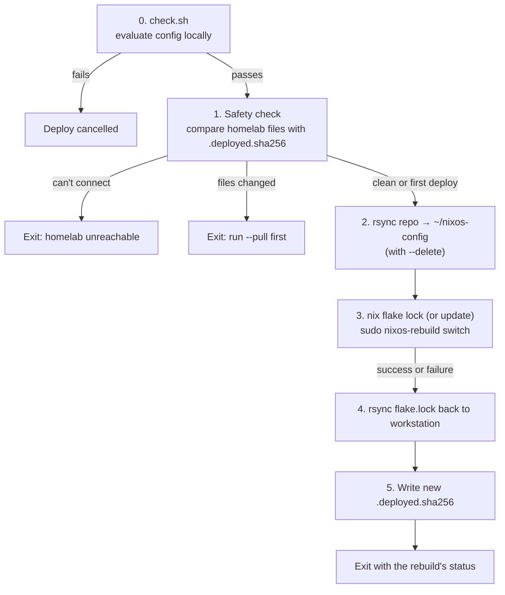

# Deployment

The repo is edited on a workstation and pushed to the homelab with
`deploy.sh`. The homelab builds and switches to the new config itself.
`check.sh` catches mistakes on the workstation before anything is copied.

## Requirements on the workstation

- **Nix**, with flakes. `check.sh` uses it to evaluate the config. Without it
  `check.sh` fails, so a normal deploy fails too.
- **`ssh` and `rsync`**, and an SSH host alias called `homelab` that logs in
  as the homelab user without a password prompt (key-based auth). The alias
  is set in `HOST` at the top of `deploy.sh`.
- **`private.nix`** in the repo folder. It's gitignored, so a fresh clone
  doesn't have it. Copy `private.example.nix` and fill it in.
- **`sops` and an age key** listed in `.sops.yaml`, to add or change secrets in
  `secrets/secrets.yaml` ([Secrets](secrets.md)). The deploy itself never
  decrypts anything on the workstation: `secrets.yaml` is copied still
  encrypted, and the homelab decrypts it with its own key during the rebuild.

## Checking the config: `check.sh`

```sh
./check.sh
```

Evaluates the full NixOS config without building it, so syntax errors, wrong
option names, wrong types and missing files show up in seconds, before
anything is copied.

A passing check means the config *evaluates*. A build can still fail on the
homelab, and a service can still fail at runtime.

## Deploying: `deploy.sh`

```sh
./deploy.sh            # normal deploy
./deploy.sh --update   # update nixpkgs and every other flake input, then deploy
./deploy.sh --pull     # copy edits made directly on the homelab back to the workstation
./deploy.sh --force    # skip the config check and the safety check
```

The config lives in `~/nixos-config` on the homelab (`REMOTE_DIR`).



### 0. Config check

Runs `check.sh`. If evaluation fails, the deploy stops before touching the
homelab. Skipped with `--force`.

### 1. Safety check

After every deploy, the homelab stores `.deployed.sha256`: a SHA-256 of every
file in `~/nixos-config`. Before copying, the script asks the homelab to verify
its files against that list.

- **Every file matches**: nothing changed since the last deploy, so
  overwriting is safe.
- **A file differs**: The homelab's copy was edited directly, for example
  a quick fix over SSH. The deploy stops rather than wipe that work.
  Run `./deploy.sh --pull`, review with `git diff`, then deploy again.
- **No fingerprint file**: first deploy, so the check is skipped.
- **ssh exits with 255**: the homelab can't be reached. This is reported
  separately so a switched-off machine isn't mistaken for changed files.

Skipped with `--force`.

### 2. Copy

```
rsync -avz --delete ... ./ homelab:nixos-config/
```

Sends the folder exactly as it is on disk, including uncommitted changes and
`private.nix`. `--delete` removes files on the homelab that were deleted
locally, so the two copies match.

Excluded, because the homelab doesn't need them to build: `.git`, `.DS_Store`,
`.deployed.sha256`, `deploy.sh`, `check.sh`, `.gitignore`, `.sops.yaml` and
`docs/`.

### 3. Rebuild

```
ssh -t homelab "cd nixos-config && nix flake lock && sudo nixos-rebuild switch --flake .#homelab"
```

- `nix flake lock` runs **as the normal user, before** the `sudo` rebuild. It
  only adds inputs missing from `flake.lock`, but it means the lock file is
  written by the user rather than root. A root-owned `flake.lock` would make
  the next rsync fail.
- With `--update`, `nix flake update` runs instead and moves every input to its
  latest version.
- `-t` gives ssh a terminal so `sudo` can ask for a password.
- A failed rebuild doesn't stop the script. Steps 4 and 5 still run so both
  machines stay in sync, and the script exits with the rebuild's status at the
  end.

`nixos-rebuild switch` activates the new system straight away. If something
breaks, the previous generation is still in the systemd-boot menu.

### 4. Sync `flake.lock` back

The rebuild may have created or changed `flake.lock`: on the first deploy,
after adding a new input to `flake.nix`, or with `--update`. It's copied back
to the workstation so the repo always records the exact versions the homelab
built.

To update just one input, run this on the workstation and then deploy normally:

```sh
nix flake update <input>     # e.g. nix flake update vpn-confinement
```

### 5. New fingerprint

Writes a fresh `.deployed.sha256` on the homelab. This happens after the
rebuild, so the rebuild's change to `flake.lock` isn't reported as a manual
edit on the next deploy.

## `--pull`

Copies everything in `~/nixos-config` on the homelab back into the local
folder, then writes a new fingerprint on the homelab so the next deploy goes
through. It doesn't delete local files, and nothing is rebuilt.

## Troubleshooting

| Message                                                         | Meaning / fix                                                                                                          |
| --------------------------------------------------------------- | ---------------------------------------------------------------------------------------------------------------------- |
| `nix isn't installed on this … so the config can't be checked.` | Install Nix on the workstation, or deploy with `--force` (skips the check)                                             |
| `Can't reach the homelab. Is it switched on?`                   | SSH timed out after 10 s. Check it's powered on, on the network or Tailscale, and that the `homelab` SSH alias works   |
| `Files on the homelab changed since the last deploy.`           | Run `./deploy.sh --pull`, review with `git diff`, deploy again                                                         |
| `No flake.lock on the homelab yet (the build stopped early).`   | The rebuild failed before locking. Fix the error shown above it and redeploy                                           |
| rsync permission error on `flake.lock`                          | It's owned by root (from a manual `sudo nix flake …`). Fix with `ssh homelab sudo chown $USER nixos-config/flake.lock` |
