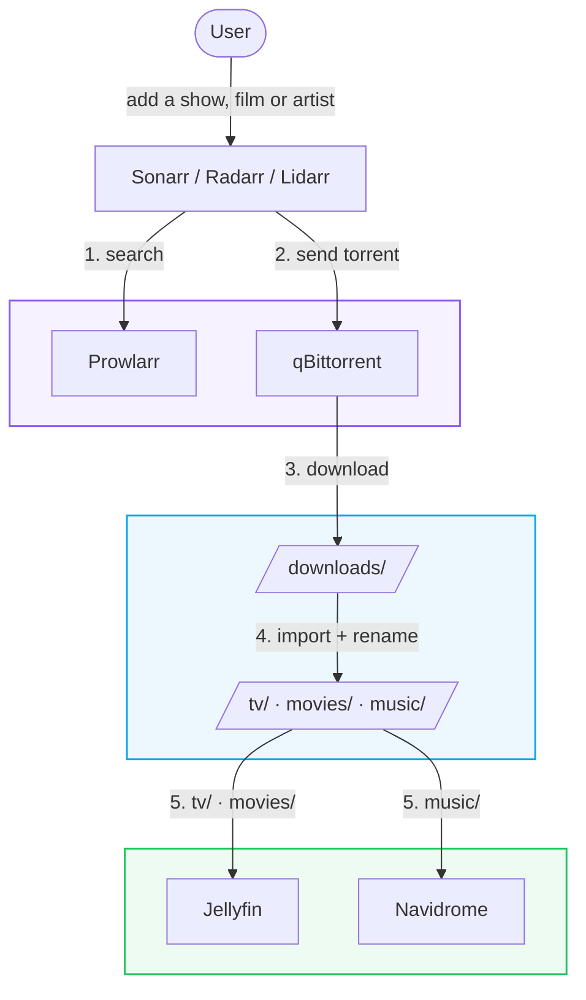
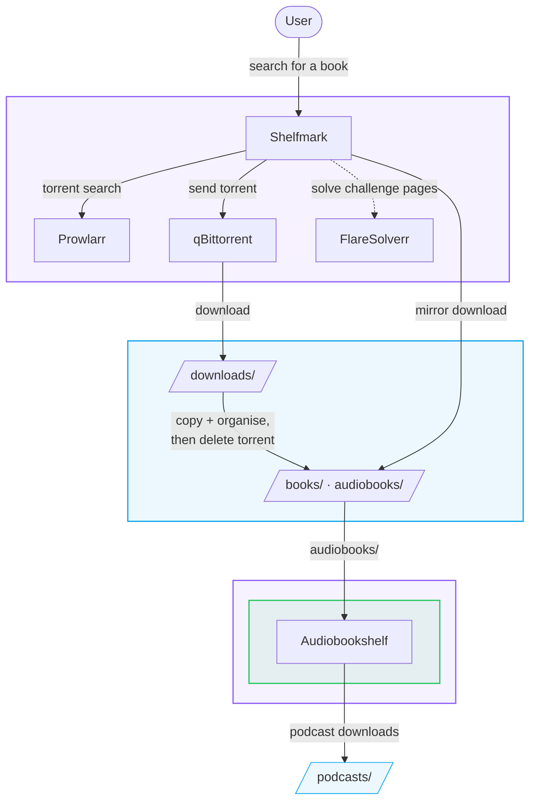

# Media stack

Everything in `services/media-stack/`. The apps find, download, organise and
stream TV, films, music, ebooks, audiobooks and podcasts. Anything that talks to
torrent trackers or download mirrors runs in the [VPN namespace](network.md#vpn-namespace).

## The services

| Service            | What it does                                                                                | Runs in               | HTTPS name                |
| ------------------ | ------------------------------------------------------------------------------------------- | --------------------- | ------------------------- |
| **Jellyfin**       | Streams TV and films to any device, with hardware transcoding                               | Host                  | `jellyfin.<domain>`       |
| **Sonarr**         | Tracks TV series: finds new episodes, sends them to qBittorrent, imports and renames them   | Host                  | `sonarr.<domain>`         |
| **Radarr**         | The same as Sonarr, for films                                                               | Host                  | `radarr.<domain>`         |
| **Lidarr**         | The same as Sonarr, for music albums                                                        | Host                  | `lidarr.<domain>`         |
| **Prowlarr**       | Manages indexers in one place and syncs them to the arr apps and Shelfmark                  | VPN                   | `prowlarr.<domain>`       |
| **qBittorrent**    | The torrent client that does the downloading                                                | VPN                   | `qbittorrent.<domain>`    |
| **FlareSolverr**   | Headless browser that gets past Cloudflare/DDoS-Guard challenges for other apps             | VPN (no port mapping) | —                         |
| **Shelfmark**      | Searches for and downloads ebooks and audiobooks, from Prowlarr indexers and direct mirrors | VPN                   | `shelfmark.<domain>`      |
| **Audiobookshelf** | Audiobook and podcast server, with apps that track listening progress. Downloads podcasts   | VPN                   | `audiobookshelf.<domain>` |
| **Navidrome**      | Music streaming server (Subsonic API), reading the music library                            | Host                  | `navidrome.<domain>`      |

On the LAN, every service is also at `http://<lanIp>:<port>`, with the ports
from `private.nix`.

## How it fits together

### TV, films and music

| Legend                                                                              |
| ----------------------------------------------------------------------------------- |
| 🟪 VPN namespace (internet only through Surfshark)<br>🟦 Media folder<br>🟩 Players |



1. You add something you want in Sonarr, Radarr or Lidarr. When it's
   released, the arr app searches **Prowlarr**. Prowlarr queries the indexers
   from inside the namespace, so searches go through the tunnel.
2. The arr app picks a release and sends it to **qBittorrent** at
   the [namespace address](network.md#whats-in-the-namespace).
3. qBittorrent downloads into `<mediaDir>/downloads`, only over `vpn0`. Seeding
   stops as soon as the download finishes.
4. The arr app sees the finished download and moves it into the
   library (`tv/`, `movies/` or `music/`), renamed into a clean folder layout.
5. **Jellyfin** scans `tv/` and `movies/`. **Navidrome** scans `music/`.

### Books and audiobooks

| Legend                                                                              |
| ----------------------------------------------------------------------------------- |
| 🟪 VPN namespace (internet only through Surfshark)<br>🟦 Media folder<br>🟩 Players |



- **Shelfmark** searches two kinds of source:
  - Prowlarr's indexers, with torrents handed to qBittorrent.
  - Direct-download mirrors, with FlareSolverr solving any challenge page.
- Every app in this flow is in the namespace, so they reach each other at
  the [namespace address](network.md#whats-in-the-namespace) without leaving it.
- Torrent downloads are **copied**, not hardlinked, so zip and rar archives get
  extracted. Afterwards Shelfmark tells qBittorrent to remove the torrent and
  its files (`remove_and_delete`).
- Ebooks are sorted into `books/<Author>/<Title> (<Year>).<ext>`. Audiobooks go
  into `audiobooks/<Author>/<Title>/`.
- **Audiobookshelf** serves `audiobooks/` and downloads podcasts into
  `podcasts/`. It runs in the namespace, so podcast downloads and metadata
  lookups go through the tunnel too.

## Folders and permissions

`services/media-stack/media.nix` creates the library under `<mediaDir>`:

```
<mediaDir>/
├── downloads/     qBittorrent's save folder
├── tv/            Sonarr → Jellyfin
├── movies/        Radarr → Jellyfin
├── music/         Lidarr → Navidrome
├── books/         Shelfmark
├── audiobooks/    Shelfmark → Audiobookshelf
└── podcasts/      Audiobookshelf
```

Each app runs as its own system user, but they all need to read and write each
other's files. Three settings make that work:

1. **A shared `media` group.** Every app that writes media joins it, and so
   does the login user:
   ```nix
   users.users.sonarr.extraGroups = [ "media" ];
   ```
   Shelfmark uses `DynamicUser`, so it has no `users.users` entry. It joins
   through `serviceConfig.SupplementaryGroups` instead.
2. **setgid folders (`2775`).** The leading `2` makes new files and folders
   inherit the `media` group instead of the creating user's own group.
3. **`UMask = "0002"`.** New files are group-writable, so for example Sonarr
   can move what qBittorrent wrote. The Sonarr, Radarr, Lidarr and Shelfmark
   modules set their own stricter UMask, so these use `lib.mkForce`.
