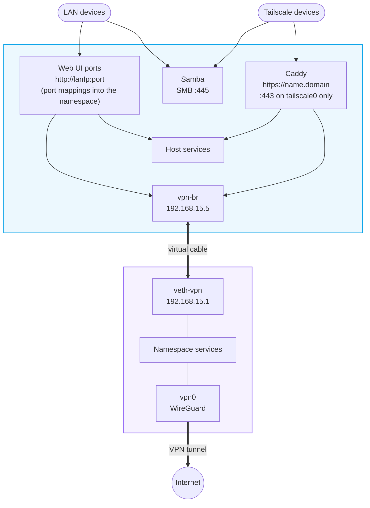
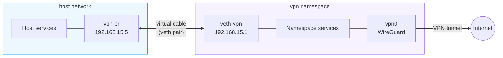

# Network

How the homelab is reached, and how its VPN-only services are kept apart from
the rest of the machine.

In this page, `<domain>`, `<lanIp>`, `<lanSubnet>` and the ports are values from
`private.nix`.

## Overview

| Legend |
| --- |
| 🟦 Homelab host network<br>🟪 VPN namespace |



There are two ways in:

- **LAN**: plain HTTP, `http://<lanIp>:<port>`.
- **Tailscale**: HTTPS with a real certificate, `https://<service>.<domain>`,
  through Caddy.

### Where each service runs

| Service        | Runs in   | LAN (`http://<lanIp>:<port>`)         | Tailscale (`https://<name>.<domain>`) |
| -------------- | --------- | ------------------------------------- | ------------------------------------- |
| Jellyfin       | Host      | Yes                                   | Yes                                   |
| Sonarr         | Host      | Yes                                   | Yes                                   |
| Radarr         | Host      | Yes                                   | Yes                                   |
| Lidarr         | Host      | Yes                                   | Yes                                   |
| Navidrome      | Host      | Yes                                   | Yes                                   |
| Beszel         | Host      | Yes                                   | Yes                                   |
| qBittorrent    | Namespace | Yes, through a port mapping           | Yes                                   |
| Prowlarr       | Namespace | Yes, through a port mapping           | Yes                                   |
| Shelfmark      | Namespace | Yes, through a port mapping           | Yes                                   |
| Audiobookshelf | Namespace | Yes, through a port mapping           | Yes                                   |
| FlareSolverr   | Namespace | No: only apps in the namespace use it | No                                    |

## Tailscale

`modules/tailscale.nix`.

- On first boot `tailscaled-autoconnect.service` logs in with the
  `tailscale-authkey` secret: a **single-use, tagged** key from the admin
  console. Once the machine has joined, the key isn't needed again, even after
  it expires.
- The node advertises `tag:homelab`, so ACLs can target it by tag instead of by
  user.
- `openFirewall` opens Tailscale's UDP port, so devices can connect directly
  instead of through a relay.
- The homelab is an **exit node**. `useRoutingFeatures = "server"` turns on IP
  forwarding, and `extraSetFlags` advertises the exit node through
  `tailscaled-set.service` on every start. Exit-node traffic leaves through the normal ISP connection, not the VPN namespace.

Tailscale devices get addresses in `100.64.0.0/10`. That range is used in the
Samba allow-list below.

## Certificates

`services/certs.nix` gets **one wildcard certificate**, for `<domain>` and
`*.<domain>`, from Let's Encrypt using NixOS's `security.acme` (lego).

Let's Encrypt has to see proof that you control the domain. This uses the
**DNS-01** challenge: lego uses the Porkbun API (keys in the `porkbun-acme`
secret) to create a temporary `_acme-challenge` TXT record, Let's Encrypt checks
it, and the record is removed. Let's Encrypt never has to connect to the
homelab, so no ports are open to the internet, and the certificate works even
though the services are only reachable on Tailscale.

Renewal is automatic (a systemd timer). Caddy's NixOS module gives Caddy read
access to the certificate and reloads Caddy when it's renewed.

## Caddy reverse proxy

`services/reverse-proxy.nix` keeps a list of service → backend address. Each
entry becomes a virtual host `https://<name>.<domain>` that uses the wildcard
certificate (`useACMEHost`) and does `reverse_proxy <backend>`.

```nix
services = {
  jellyfin = "127.0.0.1:${toString private.jellyfinPort}";   # on the host
  prowlarr = "${vpn}:${toString private.prowlarrPort}";      # in the namespace
  ...
};
```

- Services on the host are proxied to `127.0.0.1:<port>`.
- Services in the VPN namespace are proxied to the **namespace address**,
  `192.168.15.1:<port>` (`config.vpnNamespaces.vpn.namespaceAddress`).
- Port 443 is only opened on `tailscale0`, so HTTPS is a Tailscale-only way in.
  The LAN keeps using `http://<lanIp>:<port>`.

To add a service, add one line to the `services` set.

The `*.<domain>` names have to resolve to the homelab's Tailscale address. That
DNS record lives outside this repo.

## VPN namespace

`modules/vpn.nix`, using [VPN-Confinement](https://github.com/Maroka-chan/VPN-Confinement).

Some services only ever use the VPN: qBittorrent, Prowlarr, Shelfmark,
Audiobookshelf and FlareSolverr. Instead of routing the whole machine through
the VPN, they run inside a Linux **network namespace** called `vpn`. It has its
own interfaces, routes and firewall, separate from the host's.

### What's in the namespace

The namespace has exactly two connections to anything outside it:

1. **`vpn0`**: the WireGuard interface, set up from the `surfshark.conf`
   secret. It's the namespace's default route, so **the VPN tunnel is
   the only way out to the internet**.
2. **The "virtual cable"**: a veth pair. One end, `veth-vpn`, sits inside the
   namespace at **`192.168.15.1`** (the namespace address). The other end is
   plugged into a bridge, `vpn-br`, on the host's normal network at
   **`192.168.15.5`** (the bridge address). **This is the only link between
   the namespace and the rest of the homelab.**



Both addresses are VPN-Confinement's defaults. The repo doesn't set them, but
refers to them as `config.vpnNamespaces.vpn.namespaceAddress` and
`bridgeAddress`.

### Kill switch and DNS

The namespace's firewall only lets **replies** leave over the veth. Any new
outgoing connection over the veth is dropped. If the tunnel goes down, apps in
the namespace lose the internet; they can't fall back to the home connection.

DNS uses the `DNS =` servers from the WireGuard config. Port-53 traffic is
policy-routed into the tunnel, and anything that would leak over the veth is
dropped.

qBittorrent is also bound to `vpn0` in its own settings, as a second safeguard.

### Getting in: `portMappings` and `allowedIngress`

Each confined service adds its web UI port to `vpnNamespaces.vpn.portMappings`
in its own module:

```nix
vpnNamespaces.vpn.portMappings = [
  { from = private.prowlarrPort; to = private.prowlarrPort; }
];
```

A port mapping does two things:

- On the host, traffic arriving at `<lanIp>:<from>` is forwarded (DNAT) to
  `192.168.15.1:<to>` in the namespace.
- Inside the namespace, `<to>` is opened on the veth.

`allowedIngress = [ private.lanSubnet ]` in `modules/vpn.nix` adds a route in the
namespace back to the LAN through the bridge. Without it, replies to LAN
clients would go out through the tunnel and never arrive.

As a result:

| From                            | To a namespace service         | Works?                                                                    |
| ------------------------------- | ------------------------------ | ------------------------------------------------------------------------- |
| LAN device                      | `http://<lanIp>:<port>`        | Yes: port mapping, then reply through `allowedIngress`                    |
| Host process (Caddy, Sonarr, …) | `http://192.168.15.1:<port>`   | Yes: same subnet as the bridge                                            |
| Tailscale device                | `https://<name>.<domain>`      | Yes, through Caddy                                                        |
| Tailscale device                | `http://<tailscale-ip>:<port>` | No: `100.64.0.0/10` isn't in `allowedIngress`, so replies take the tunnel |
| Another app in the namespace    | `http://192.168.15.1:<port>`   | Yes, without a port mapping (this is how Shelfmark reaches FlareSolverr)  |

### Getting out to the host: `allowedEgress`

Sometimes an app in the namespace has to start a connection to the host.
Prowlarr pushes indexers to Sonarr, Radarr and Lidarr, for example.
`services/media-stack/prowlarr.nix` allows that with:

```nix
vpnNamespaces.vpn.allowedEgress = [ config.vpnNamespaces.vpn.bridgeAddress ];
```

The namespace may then open new connections to `192.168.15.5` (the host) over
the veth. Everything else still only leaves through the tunnel. In Prowlarr,
the arr apps are added as `http://192.168.15.5:<port>`.

### Confining a new service

In the service's module:

```nix
systemd.services.<name>.vpnConfinement = {
  enable = true;
  vpnNamespace = "vpn";
};

# Only if it has a web UI that should be reachable from outside the namespace
vpnNamespaces.vpn.portMappings = [
  { from = private.<name>Port; to = private.<name>Port; }
];
```

Also:

- Make the app listen on `0.0.0.0`, not `127.0.0.1`. A port mapping
  delivers to the veth address, so an app on localhost can't be reached.
- Don't set `openFirewall`. The port mapping handles access, and the port
  shouldn't be open on the host.
- In `reverse-proxy.nix`, point it at `${vpn}:<port>`, not `127.0.0.1`.

Useful commands on the homelab:

```sh
sudo ip netns exec vpn curl https://ifconfig.me   # should show a Surfshark IP
sudo ip netns exec vpn wg show                     # tunnel status
systemctl status vpn.service                       # namespace setup unit
```

## File sharing (Samba + Avahi)

`services/file-sharing.nix` shares the homelab's filesystem over SMB, so it
appears in a file manager like a network drive.

- **Who can connect**: `hosts allow` limits it to the LAN subnet, Tailscale
  (`100.64.0.0/10`) and localhost. Everyone else is denied.
- **Security**: SMB3 only, with encryption required on every connection. No
  guest access.
- **The share**: one share, `root`, mapped to `/` as the login user.
  Normal Linux permissions still apply, so system files are read-only.
- **Apple clients**: the `fruit` and `streams_xattr` VFS modules store Finder
  metadata properly instead of leaving `._` files next to everything copied.
- **Discovery**: Avahi (Bonjour/mDNS) advertises `_smb._tcp` on port 445, so the
  homelab appears under Network in the sidebar.

Samba keeps its own password database, separate from Linux logins. Set it once
on a fresh install (it survives rebuilds):

```sh
ssh -t homelab sudo smbpasswd -a <username>
```

## SSH

`services/ssh.nix` enables OpenSSH with NixOS's defaults. Deploys use it
([Deployment](deployment.md)), and sops-nix uses its ed25519 host key to
decrypt secrets ([Secrets](secrets.md)).

## Firewall summary

| Port                            | Interface         | For                                                           |
| ------------------------------- | ----------------- | ------------------------------------------------------------- |
| 443/tcp                         | `tailscale0` only | Caddy HTTPS                                                   |
| Each host service's web UI port | All               | `openFirewall` on Jellyfin, Sonarr, Radarr, Lidarr, Navidrome |
| 8090/tcp                        | All               | Beszel hub (its module has no `openFirewall`)                 |
| 139, 445/tcp                    | All               | Samba; `hosts allow` decides who gets in                      |
| 5353/udp                        | All               | Avahi / mDNS                                                  |
| Tailscale UDP                   | All               | Direct Tailscale connections                                  |
| Namespace web UI ports          | None on the host  | Reached through port mappings, not the host firewall          |
